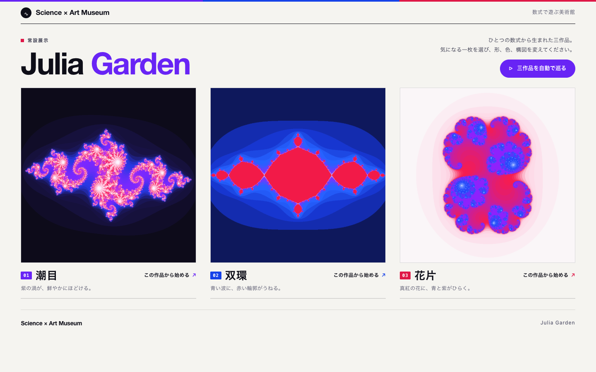

# Science × Art Museum

Science × Art Museum is a browser-based gallery for generative art made from mathematics. Its first exhibition, **Julia Garden**, turns the escape behavior of complex-number orbits into color. Visit the three works, watch their forms change, or use the studio to make a composition of your own.

[Visit the live museum](https://science-art-museum.pages.dev/)



## Explore Julia Garden

| Work | Starting parameter | What to look for |
| --- | --- | --- |
| Tide · 潮目 | −0.8 + 0.156i | Violet currents curl into two bright spirals. |
| Double Ring · 双環 | −1 | A red contour links the dark forms against a blue field. |
| Petals · 花片 | 0.285 + 0.01i | Small blue and violet curls emerge from a crimson field. |

- Open a work to change its parameter on the Mandelbrot map, choose a palette, and pan or zoom. The interface labels are in Japanese.
- Select **三作品を自動で巡る** to tour all three works. Each scene recalculates its pattern as the Julia parameter changes. Pause the tour or select **自分で動かす** to edit the scene you are looking at.
- Select **作品を保存** in the studio to download the finished PNG and its companion settings JSON. Use **設定を読み込む** to render those settings again in a new session. The tour, studio, and file handling run entirely in the browser.

## Run locally

Use Node.js **26.13.1** (pinned in `.node-version`) and npm. Run these commands from the checkout:

```sh
npm ci
npm run dev
```

Open [http://127.0.0.1:5173/](http://127.0.0.1:5173/) or the address printed by Vite. The museum needs a modern browser with JavaScript modules, Web Workers and Canvas 2D. File integrity checks use Web Crypto on HTTPS or a local loopback origin. The layout is responsive. Browser and device performance vary, especially during the live tour.

```sh
npm test
npm run typecheck
npm run build
npm run build:pages
npm run preview -- --outDir dist-pages
```

The builds write static files to `dist/` and `dist-pages/`. Serve the output directory at the root of an HTTP origin. The Pages output includes the static headers and 404 page. The app uses hash routes and needs no API, account, tokens or environment variables.

## How it works

TypeScript and Vite build the gallery and studio. The numerical engine samples pixel centers and iterates **zₙ₊₁ = zₙ² + c** with JavaScript binary64 arithmetic. For Julia images, **c** is fixed within each frame and **z₀** varies by pixel. The Mandelbrot map instead varies **c** with **z₀ = 0**. Rendering workers compute escape counts, the palette maps them to colors, and Canvas displays the result. The live tour samples a separate parameter path for each work and adjusts its raster size to available processing time. Reduced-motion settings use still artwork.

- `src/numerics/` contains the escape-time engine and coordinate contract.
- `src/art/` holds the work definitions and palettes. The build verifies the generated gallery images and map against fresh numerical output.
- `src/product/` and `src/tour/` manage rendering and the automatic tour.
- `src/save/` stores the settings and verifies a newly rendered image on reload.

The renderer uses finite resolution, precision and iteration limits. “Unescaped” means the orbit stayed within the escape radius for the chosen iteration budget. This visualizes escape behavior around the filled Julia set and its boundary. The moving patterns are mathematical renderings, not a simulation of physical marbling.

## Rights and third-party software

Rights in the project code, design, and generated artwork are reserved by their respective holders. This snapshot carries no project-wide license. Packages installed from npm retain their own licenses and notices. See [Third-party software](THIRD_PARTY.md).
